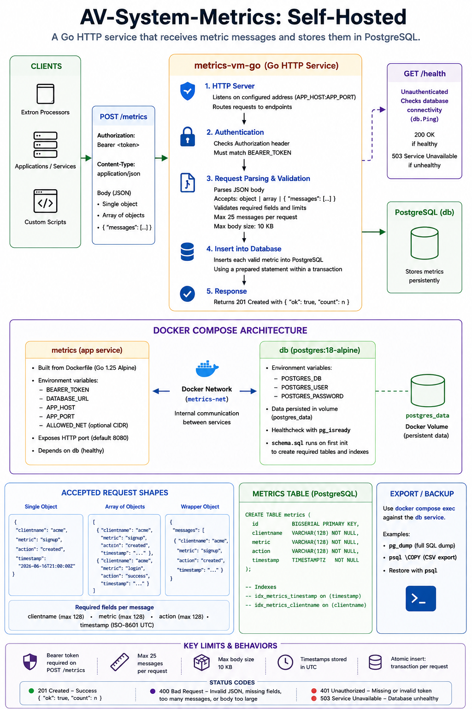

# AV-System-Metrics: Self-Hosted

Self-Hosted Docker Compose system using Go and PostgreSQL for AV system metric ingestion.

- Client: Any control system that can send REST web requests
- Server: Any server or VM running Docker Engine with Docker Compose

## Requirements

- A server running Docker Engine with the Docker Compose plugin **version 2.20 or newer** (check with `docker compose version`) and a SSH console session to said server. This server can be a virtual machine.
- `curl` or another way to download the stack files to the server.
- Module added to your control processor codebase. See the [Clients](/Clients/) folder for current supported systems, or please consider writing one with the [Developer Guide](/Clients/Developer%20Guide/README.md) and sending a PR to add it here if your system is not listed.

## Architecture

AI generated image, may contain mistakes:


Docker Compose Stack stands up:

- `metrics-ingest` - the Go HTTP ingest service, published at `ghcr.io/mefranklin6/av-system-metrics/metrics-ingest`
- `postgres` - PostgreSQL Alpine from DockerHub
- `postgres_data` - named Docker volume for database persistence
- `analytics-api` - optional, off by default: a read-only reporting API for the Metrics Visualizer and your own apps. See [Analytics API (optional)](#analytics-api-optional).

PostgreSQL is only available inside the Compose network by default. Set `EXPOSE_DATABASE=true` in `.env` when you need to publish it for pgAdmin or similar database tools.

### Endpoints

- `POST /metrics` - authenticated metric ingest endpoint
- `GET /health` - unauthenticated database health check

## Configure

The server needs the following files from this repo:

- `docker-compose.yml` - defines the app and PostgreSQL services
- `docker-compose.database-expose-false.yml` and `docker-compose.database-expose-true.yml`
- `docker-compose.analytics-false.yml` and `docker-compose.analytics-true.yml` - turn the optional [Analytics API](#analytics-api-optional) off or on
- `update.sh` - safely updates the stack and merges new configuration settings
- `maintenance.sh` - reclaims disk space during a manually started maintenance window
- `lifecycle-events.sh` - required support file for updates and maintenance
- `.env.example` - the configuration template used when merging updates
- `.env` - local secrets and runtime settings

Commands to create a working directory and download the stack files:

```sh
mkdir -p av-system-metrics
cd av-system-metrics

AVSM_REF=main
BASE_URL="https://raw.githubusercontent.com/mefranklin6/AV-System-Metrics/${AVSM_REF}/Self_Hosted"

curl -fsSL "${BASE_URL}/docker-compose.yml" -o docker-compose.yml
curl -fsSL "${BASE_URL}/docker-compose.database-expose-false.yml" -o docker-compose.database-expose-false.yml
curl -fsSL "${BASE_URL}/docker-compose.database-expose-true.yml" -o docker-compose.database-expose-true.yml
curl -fsSL "${BASE_URL}/docker-compose.analytics-false.yml" -o docker-compose.analytics-false.yml
curl -fsSL "${BASE_URL}/docker-compose.analytics-true.yml" -o docker-compose.analytics-true.yml
curl -fsSL "${BASE_URL}/.env.example" -o .env.example
curl -fsSL "${BASE_URL}/update.sh" -o update.sh
curl -fsSL "${BASE_URL}/maintenance.sh" -o maintenance.sh
curl -fsSL "${BASE_URL}/lifecycle-events.sh" -o lifecycle-events.sh
cp .env.example .env
chmod +x update.sh
chmod +x maintenance.sh
```

Leave all downloaded files together in this directory.

***Edit `.env` with your preferred editor (such as `sudo nano .env`) before starting the stack!***

### Required Configuration Values

- `BEARER_TOKEN` - required. Make it a long random string and keep a note of it for when you setup your clients.
- `POSTGRES_PASSWORD` - required; password for the Compose-managed PostgreSQL user. Keep this URL-Safe; Avoid characters such as `@`, `/`, `:`, `?`, `#`, `&`, and spaces

The stack refuses to start if `BEARER_TOKEN` is still `change-me-long-random-token` or `POSTGRES_PASSWORD` is still `change_me_url_safe_database_password` from `.env.example`.

### Optional Configuration Values

- `EXPOSE_DATABASE` - optional; set to `true` to publish PostgreSQL for pgAdmin or similar tools. Defaults to `false`.
- `DATABASE_HOST` - optional; host address Docker binds for PostgreSQL when `EXPOSE_DATABASE=true`. Defaults to `127.0.0.1`.
- `DATABASE_PORT` - optional; host port Docker publishes for PostgreSQL when `EXPOSE_DATABASE=true`. Defaults to `5432`.
- `APP_HOST` - optional; host address Docker binds for the app. Defaults to `127.0.0.1` which is for testing and reverse proxy usage. If you need to expose the service, use `0.0.0.0` but only on a trusted network.
- `APP_PORT` - optional; host port Docker publishes for the app. Defaults to `8080`.
- `ALLOWED_NET` - optional CIDR allow-list, for example `203.0.113.0/24`.
- `METRICS_INGEST_IMAGE` - optional; app image to run. Defaults to `ghcr.io/mefranklin6/av-system-metrics/metrics-ingest:main`. For stricter change control, pin this to a `sha-<commit>` tag or image digest.
- `METRICS_INGEST_PULL_POLICY` - optional; Docker Compose pull behavior for the app image. Defaults to `always`.
- `METRICS_INGEST_CPUS`, `METRICS_INGEST_MEMORY_LIMIT`, `METRICS_INGEST_PIDS_LIMIT` - optional runtime ceilings for the app container.
- `POSTGRES_CPUS`, `POSTGRES_MEMORY_LIMIT`, `POSTGRES_PIDS_LIMIT` - optional runtime ceilings for the PostgreSQL container.
- `ENABLE_ANALYTICS_API` and the `ANALYTICS_*` settings - optional read-only Analytics API, `false` by default. See [Analytics API (optional)](#analytics-api-optional).

Keep `COMPOSE_PATH_SEPARATOR` and `COMPOSE_FILE` in `.env` and do not edit them. Docker Compose reads `docker-compose.yml` first, then selects either `docker-compose.database-expose-false.yml` or `docker-compose.database-expose-true.yml` from the `EXPOSE_DATABASE` flag. The `false` file intentionally changes nothing. The `true` file adds the PostgreSQL host port mapping. Finally it selects `docker-compose.analytics-false.yml` or `docker-compose.analytics-true.yml` from the `ENABLE_ANALYTICS_API` flag. The updater always resets the settings below `#### Do not modify below this line ####` to the current template so new Compose files are picked up. If you added your own Compose file to `COMPOSE_FILE`, the updater warns that it is dropped and `--remove-orphans` then removes its containers; run extra services as a separate Compose project instead.

Heartbeat records are automatically deleted 30 days after receipt. Change `HEARTBEAT_RETENTION_DAYS` to adjust retention, or set `PURGE_HEARTBEAT=false` to keep them indefinitely. Cleanup runs at startup and daily; other metrics are retained. To reclaim disk space after a large cleanup, see [Maintenance](#maintenance).

## Start

Pull and start the full stack from the directory containing `docker-compose.yml`:

```bash
docker compose pull
docker compose up -d
```

Once started, the services will remain running until `docker compose down` or a system shutdown. The services will restart if the host restarts.

## Updating the System

Fetch the current updater from GitHub before each update. Run this from the server directory that contains the existing Compose files and `.env`:

```sh
AVSM_REF=main
curl -fsSL "https://raw.githubusercontent.com/mefranklin6/AV-System-Metrics/${AVSM_REF}/Self_Hosted/update.sh" -o update.latest.sh
bash update.latest.sh --ref "$AVSM_REF" && rm -f update.latest.sh
```

This also works for installations created before `update.sh` was included. The updater saves the previous `update.sh` with the other configuration files, then installs the current copy. If the update fails, remove `update.latest.sh` after investigating the error.

Always start an update this way, with a freshly downloaded `update.latest.sh`, including when you add the options below. Updaters installed before the Analytics API release overwrite themselves while they run: started as `bash update.sh`, they install the new files and then stop with "the previous update.sh replaced itself while it was running" before merging `.env` or changing any container. If that happens, run the update again; the new updater finishes it.

Do not download `.env.example` over `.env`. On this first update, the script will note that it has no previous template and conservatively preserve every existing value, except the Compose file selection below `#### Do not modify below this line ####`, which always follows the template. It installs `.env.example` as the baseline for three-way merges on later updates.

The updater:

- Downloads the latest Compose files, `.env.example`, updater, and maintenance command from the selected repository ref.
- Performs a three-way `.env` merge using the previous template. Local values and secrets are preserved, unchanged defaults adopt new template defaults, new settings are added, and conflicting or retired settings are reported by name without printing their values. Settings below `#### Do not modify below this line ####` (`COMPOSE_PATH_SEPARATOR`, `COMPOSE_FILE`) always take the new template value and are reported by name.
- Validates the merged Compose configuration, including the overlays selected by `EXPOSE_DATABASE` and `ENABLE_ANALYTICS_API` (each must be `true` or `false`), before changing live files. When the Analytics API is enabled, it also refuses example, too-short, or reused Analytics API secrets before anything changes.
- Refuses automatic PostgreSQL major-version changes.
- Asks whether to back up the PostgreSQL database (the default is yes), then whether to store the backup on the server or on a workstation. The previous configuration is always backed up.
- For a server backup, shows the proposed directory (`.avsm-backups/` in the stack directory). Press Enter to accept it or type another absolute directory, such as a mounted backup volume; the updater creates a timestamped folder inside it.
- The workstation choice copies the previous configuration and PostgreSQL dump with SCP before applying the update.
- Pulls the configured images using the new files before changing anything, so an unavailable image stops the update with the running stack untouched.
- Installs each file by writing a temporary copy and renaming it into place, then recreates the services with `docker compose up -d --remove-orphans`, which also removes the Analytics API containers after it is turned off. The `postgres_data` named volume remains in place; the updater never runs `docker compose down -v`.

Preview and validate an update without changing files, backing up the database, or restarting containers:

```sh
bash update.sh --check
```

The default source for the managed stack files is the `main` branch. Use `--ref` to select another branch, tag, or commit; the container image remains controlled separately by `METRICS_INGEST_IMAGE` in `.env`:

```sh
AVSM_REF=<branch-tag-or-commit>
curl -fsSL "https://raw.githubusercontent.com/mefranklin6/AV-System-Metrics/${AVSM_REF}/Self_Hosted/update.sh" -o update.latest.sh
bash update.latest.sh --ref "$AVSM_REF" && rm -f update.latest.sh
```

### Backing up to a Linux Workstation

For a workstation backup, the workstation must run an SSH server reachable from the AV server (Windows workstations usually do not; see [Backing Up to a Windows Workstation](#backing-up-to-a-windows-workstation)). Create the destination directory on the workstation first, and make sure the SSH account can write to it. At the prompt, enter a destination such as `backupuser@workstation.example:/home/backupuser/avsm-backups`. For a Windows workstation running OpenSSH Server, use a drive path such as `backupuser@workstation.example:/C:/avsm-backups`; domain accounts such as `jdoe@campus.edu@workstation.example:/C:/avsm-backups` are accepted. Paths may not contain spaces or `..`. To use a non-default SSH port or key, define a `Host` alias in the server's `~/.ssh/config` and use that alias as the host. The updater temporarily builds the backup under `.avsm-backups/` on the server, copies it to the workstation, and removes the server copy after SCP succeeds. If SCP fails, the update stops and leaves the server copy available for recovery.

For an unattended update, select the destination with options (after downloading `update.latest.sh` as shown in [Updating the System](#updating-the-system)):

```sh
bash update.latest.sh --backup-location workstation --workstation-destination backupuser@workstation.example:/home/backupuser/avsm-backups
```

Use `--backup-location server` for an unattended server backup, and add `--backup-dir /absolute/path` to store it outside the stack directory (`--backup-dir` alone implies a server backup). When no terminal is available and no location is selected, the updater uses `.avsm-backups/` on the server. `--check` skips the backup prompts.

If `METRICS_INGEST_IMAGE` (or `ANALYTICS_API_IMAGE` while the Analytics API is enabled) is pinned to a `sha-<commit>` tag or image digest, the updater installs and validates the new stack files but stops before pulling or restarting containers. Review `.env`, select the intended image, and run the updater again. Because no container is restarted, changes to `ENABLE_ANALYTICS_API` or `ANALYTICS_API_TOKEN` are not applied yet either; if the Analytics API is running, the updater says so, and `docker compose stop analytics-api` revokes its access immediately.

By default, an update stops without changing the stack when the running PostgreSQL service cannot be backed up. Answering `n` to the database backup prompt, or passing `--skip-database-backup`, overrides that protection and should only be used when you already have a verified backup or explicitly accept the risk.

### Backing Up to a Windows Workstation

Windows workstations don't run an SSH server by default, so option 2 won't work. Use option 1 and pull the backup instead:

1. Run the update and choose `1`. Note the backup path it prints:

   ```text
   Update complete. Configuration and database backup: /home/avadmin/av-system-metrics/.avsm-backups/20261027T180000Z
   ```

2. On the workstation, in PowerShell:

   ```powershell
   scp -r avadmin@avserver.example:/home/avadmin/av-system-metrics/.avsm-backups/20261027T180000Z C:\avsm-backups\
   ```

   Use the same account that ran the update.

3. Verify the hashes match:

   ```sh
   sha256sum .avsm-backups/20261027T180000Z/metrics.dump    # server
   ```

   ```powershell
   Get-FileHash C:\avsm-backups\20261027T180000Z\metrics.dump    # workstation
   ```

4. On the server, from the stack directory, remove the server copy:

   ```sh
   rm -rf -- .avsm-backups/20261027T180000Z
   ```

The backup includes `.env`, so store it securely.

### Restoring a database backup

`metrics.dump` is a `pg_dump` custom-format archive of the `metrics` database. It does not contain database roles. If the Analytics API was enabled when the backup was made, the archive includes permissions for the `metrics_reader` role, which a fresh database does not have yet; restore without permissions and let provisioning recreate them.

1. Stop ingestion and the Analytics API (if enabled) so nothing writes during the restore: `docker compose stop metrics-ingest analytics-api` (omit `analytics-api` when it is disabled).
2. Copy the dump into the database container and restore it over the existing tables:

   ```sh
   docker compose exec -T postgres sh -c 'cat > /tmp/metrics.dump' < .avsm-backups/<timestamp>/metrics.dump
   docker compose exec postgres pg_restore -U metrics_user -d metrics --clean --if-exists --no-owner --no-privileges /tmp/metrics.dump
   docker compose exec postgres rm -f /tmp/metrics.dump
   ```

3. Start the stack again with `docker compose up -d --remove-orphans`. When the Analytics API is enabled, its provisioning job re-creates the `metrics_reader` grants and indexes before the API starts.

## Maintenance

Run maintenance to reclaim disk space after deleting a large number of heartbeats, such as after shortening retention. Routine cleanup frees space for future metrics; maintenance compacts the database to return unused space to the filesystem. It is started manually, so choose a quiet period.

From the server's stack directory, check readiness and preview disk usage without downtime:

```sh
bash maintenance.sh --check
```

Heartbeat purging must be enabled and have completed successfully recently. Resolve any problems reported by the check, then run:

```sh
bash maintenance.sh
```

The command pauses ingestion, compacts stored metrics, reports space reclaimed, and restores ingestion if it was running. If the optional Analytics API is running, it is paused too (its read queries would otherwise block compaction) and restored afterwards; maintenance refuses to start while the Analytics API's provisioning job is still building indexes. **Metrics generated during this window depend on client buffering and may be lost.** Database queries are also interrupted. Compaction requires spare disk space and has a default time limit of two hours; use `bash maintenance.sh --help` for options.

Keep all downloaded stack files together. Maintenance requires Bash, Docker Compose v2, and `flock` (usually included with Linux). Run it separately from updates and follow any recovery instructions if it fails. Maintenance and updates record their start, stop, and outcome as trace events under `AVSM-System` in the metric history.

## Analytics API (optional)

The Analytics API is an optional, read-only REST API (described by an OpenAPI 3.1 document) that the [Metrics Visualizer](/visualizer_app/metrics_visualizer/) uses to load room and device usage, and that you can use to build your own reports and apps. It is **off by default**, separate from data collection, and turning it on or off does not change how metrics are ingested. Full documentation, every endpoint, and curl/PowerShell examples are in the [Analytics API README](/Self_Hosted/analytics_api/README.md).

When `ENABLE_ANALYTICS_API=true`, Compose adds two services from `docker-compose.analytics-true.yml`:

- `analytics-db-provision` - a one-shot job that runs after ingestion is healthy. It creates or updates the restricted `metrics_reader` database role (read-only, `SELECT` on only the columns the API needs, no client IP addresses) and builds two supporting indexes, then exits. Only this job receives the database owner's credentials.
- `analytics-api` - the API itself, published at `ANALYTICS_HOST:ANALYTICS_PORT` (default `127.0.0.1:8081`). It connects as `metrics_reader` and refuses to start if that role could write.

### Enabling

1. Create a token and a database password, for example with `openssl rand -hex 32` and `openssl rand -hex 24`.
2. Edit `.env`:

   ```sh
   ENABLE_ANALYTICS_API=true
   ANALYTICS_API_TOKEN=<long random token>
   ANALYTICS_DB_PASSWORD=<long random password>
   ANALYTICS_HOST=127.0.0.1
   ANALYTICS_PORT=8081
   ANALYTICS_ALLOWED_NET=
   ANALYTICS_CORS_ORIGINS=
   ```

   - `ANALYTICS_API_TOKEN` - required; 32 to 512 characters from `A-Z a-z 0-9 . _ ~ + / = -` (such as `openssl rand -hex 32`). List several separated by commas to rotate tokens or give each person or app its own. Characters such as `$`, quotes, and `#` are refused because Docker Compose changes them when it reads `.env`.
   - `ANALYTICS_DB_PASSWORD` - required; 16 to 128 characters using only `A-Z a-z 0-9 . _ ~ -`.
   - `ANALYTICS_HOST` - keep `127.0.0.1` when a reverse proxy on this server publishes the API; use `0.0.0.0` only on a trusted network.
   - `ANALYTICS_ALLOWED_NET` - optional CIDR allow-list, such as `10.20.0.0/16`.
   - `ANALYTICS_CORS_ORIGINS` - exact browser origins, such as `https://viz.example.edu`. **Required for the web build of the visualizer**: list the origin the app is served from, or the browser blocks every response. The desktop builds do not need it.

   Do not reuse `BEARER_TOKEN` or `POSTGRES_PASSWORD`, and do not put comments on the same line as a value. The services refuse to start with the `.env.example` values.
3. Apply it with the updater (download and run `update.latest.sh` as in [Updating the System](#updating-the-system)), or directly:

   ```sh
   docker compose pull
   docker compose up -d --remove-orphans
   ```

   The first provisioning on a large database can take several minutes while indexes are built; ingestion keeps running. Check progress with `docker compose logs analytics-db-provision analytics-api`.
4. Test it from the server:

   ```sh
   curl -fsS http://127.0.0.1:8081/health
   curl -fsS -H 'Authorization: Bearer <analytics token>' http://127.0.0.1:8081/api/v1/info
   ```

5. Publish it through a TLS reverse proxy (nginx, Caddy, IIS ARR, or a campus load balancer) that forwards to `127.0.0.1:8081`, and allow only the proxy, or trusted reporting workstations, through the firewall. The [reverse proxy examples](/Self_Hosted/analytics_api/README.md#reverse-proxy-examples) have ready-made nginx, Caddy, and IIS configurations and a check with `curl`.
6. Connect the Metrics Visualizer. Give each person who needs reports:
   - the **public HTTPS address of the proxy**, such as `https://avsm.example.edu` or `https://avsm.example.edu/analytics` (not `http://127.0.0.1:8081`, which only works on the server itself), and
   - **their own token**, added to the comma-separated `ANALYTICS_API_TOKEN` list (apply it with `docker compose up -d --remove-orphans`). One token per person or app lets you revoke one person's access without affecting anyone else, and keeps their rate limits separate.

   In the app they open **Data source > Connect to the Analytics API**, enter the address and token, and choose **Test connection**, then **Load data**. For the web build of the Visualizer, also list the site it is served from in `ANALYTICS_CORS_ORIGINS` (step 2). To revoke access later, see the [security notes](#analytics-api-security-notes). Users who should not have API access can still use a [CSV export](#exporting-a-csv-for-the-metrics-visualizer).

Optional resource and image settings are `ANALYTICS_API_IMAGE`, `ANALYTICS_API_PULL_POLICY`, `ANALYTICS_API_CPUS`, `ANALYTICS_API_MEMORY_LIMIT`, and `ANALYTICS_API_PIDS_LIMIT`. `ANALYTICS_PROVISION_TIMEOUT` (default `15m`, in whole hours, minutes, or seconds) bounds the provisioning job; the API starts only after provisioning finishes, and the updater waits that long plus three minutes. Raise it for a very large `metric_events` table.

Repository maintainers: the first release of the Analytics API needs a one-time step on GitHub (making the new `analytics-api` container package public) before operators can pull it. See the [implementation guide](/Implementation_Guide.md).

### Exporting a CSV for the Metrics Visualizer

The [Metrics Visualizer](/visualizer_app/metrics_visualizer/README.md) can also work from a CSV export, which needs no Analytics API and no change to the server. From the install directory (where `docker-compose.yml` is), export the last 90 days:

```sh
docker compose exec -T postgres psql -U metrics_user -d metrics -c "\copy (SELECT clientname, event_timestamp, metric, action, event_id, received_at FROM metric_events WHERE event_timestamp >= now() - interval '90 days' ORDER BY event_timestamp) TO STDOUT WITH (FORMAT csv, HEADER)" > avsm_export.csv
```

Change `interval '90 days'` for another period. The export includes heartbeat rows, which the Visualizer needs for room online percentages; heartbeats older than `HEARTBEAT_RETENTION_DAYS` have already been purged. It leaves out `source_ip`. Copy `avsm_export.csv` to the workstation (for example with `scp` or WinSCP) and choose **Import a CSV export** in the app. The file contains every room's usage, so store and share it like any other internal report. The [Visualizer README](/visualizer_app/metrics_visualizer/README.md#1-csv-export-no-server-changes) has more options.

### Disabling

Set `ENABLE_ANALYTICS_API=false` and run the updater, or `docker compose up -d --remove-orphans`. Always include `--remove-orphans`; without it the old API container keeps running. The one-shot `analytics-db-disable` job (from `docker-compose.analytics-false.yml`) then sets `metrics_reader` to `NOLOGIN` and ends its database sessions, so disabling also revokes database access. On installs that never enabled the API it changes nothing. Re-enabling restores the login with the password in `.env`.

- Wait until `analytics-db-provision` has finished (`docker compose ps analytics-db-provision`) before disabling; stopping it mid-build leaves an invalid index until provisioning runs again.
- With a pinned image the updater does not restart containers (see [Updating the System](#updating-the-system)); run `docker compose stop analytics-api` to revoke access immediately.
- The API's two indexes on `metric_events` stay in place. The [Analytics API README](/Self_Hosted/analytics_api/README.md#database-indexes-and-maintenance) shows how to drop them.

### Analytics API security notes

- Access needs its own bearer token, separate from the ingest `BEARER_TOKEN`. Failed attempts are rate limited, and repeated failures block further failing attempts from the source address for 15 minutes; requests with a valid token are never blocked, so wrong tokens sent through a shared reverse proxy cannot lock everyone out. Each token is also limited to about 10 requests per second and 3 requests in progress at once per client address, so give each person or app its own token.
- If a reverse proxy publishes the API, let it pass query strings of at least 8 KiB: apps that filter by many rooms send long URLs. nginx's defaults are enough; IIS allows only 2,048 bytes of query string by default, so raise `maxQueryString` to `8192` for the API's site. See the [Analytics API README](/Self_Hosted/analytics_api/README.md#errors).
- The API can only read: it uses a separate read-only database role with column-level grants, runs every query in a read-only transaction, and checks its own privileges at startup.
- The bundled Compose overlay serves plain HTTP. Keep `ANALYTICS_HOST=127.0.0.1` and publish the API through a TLS reverse proxy (the only supported TLS setup for Compose installs), or use it only on a trusted network with `ANALYTICS_ALLOWED_NET` set. Tokens are visible to anyone who can observe plain HTTP traffic. Behind a reverse proxy on the same host, the API sees Docker's network gateway rather than `127.0.0.1`; see the [Analytics API README](/Self_Hosted/analytics_api/README.md#enable-the-api) before setting `ANALYTICS_ALLOWED_NET`.
- The containers use the same hardening as the rest of the stack: non-root user, read-only filesystem, no Linux capabilities, `no-new-privileges`, and resource limits. The API is on its own Docker network plus the internal database network.
- Remove a person's access by deleting their token from `ANALYTICS_API_TOKEN` and running `docker compose up -d --remove-orphans`.

## Testing your setup

### Healthcheck

```text
curl -i http://<host address>:<port from env file>/health
```

### Send a test metric from a workstation

Use the same token you put in `.env`:

```sh
curl -i -X POST http://127.0.0.1:8080/metrics \
  -H 'Authorization: Bearer <change-me-long-random-token>' \
  -H 'Content-Type: application/json' \
  -d '{"clientname":"workstation","metric":"trace","action":"testing","timestamp":"2026-06-16T21:00:00Z"}'
```

Successful requests return HTTP `201`:

```json
{"ok":true,"count":1}
```

## Inspecting the Database

You can `psql` inside the PostgreSQL container:

```sh
docker compose exec postgres psql -U metrics_user -d metrics
```

To exit `psql` at any time and go back to the server shell: `exit;`

Count stored events in psql:

```sql
SELECT count(*) FROM metric_events;
```

Show recent events in psql:

```sql
SELECT clientname, event_timestamp, metric, action FROM metric_events ORDER BY event_timestamp DESC LIMIT 10;
```

Show recent events in PST time zone

```sql
SELECT 
    clientname, 
    event_timestamp AT TIME ZONE 'America/Los_Angeles' AS local_timestamp, 
    metric, 
    action 
FROM metric_events 
ORDER BY event_timestamp DESC 
LIMIT 10;
```

To inspect the database from pgAdmin, DBeaver, Power BI, or another external tool, set these values in `.env` and restart the stack:

```sh
EXPOSE_DATABASE=true
DATABASE_HOST=127.0.0.1 # or 0.0.0.0
DATABASE_PORT=5432
```

## View logs

```sh
docker compose logs -f
```

View only app logs:

```sh
docker compose logs -f metrics-ingest
```

View only database logs:

```sh
docker compose logs -f postgres
```

View the optional Analytics API and its provisioning job:

```sh
docker compose logs -f analytics-db-provision analytics-api
```

## Stop

Stop containers but keep PostgreSQL data:

```sh
docker compose down
```

Stop containers and delete PostgreSQL data:

```sh
docker compose down -v
```

Use `docker compose down -v` only when you intentionally want to delete stored metric data. The app will recreate the schema on next startup.

## Accepted payload shapes

Single message:

```json
{"clientname":"workstation","metric":"trace","action":"testing","timestamp":"2026-06-16T21:00:00Z"}
```

List of messages:

```json
[
  {"clientname":"workstation","metric":"trace","action":"testing","timestamp":"2026-06-16T21:00:00Z"}
]
```

Wrapped list:

```json
{
  "messages": [
    {"clientname":"workstation","metric":"trace","action":"testing","timestamp":"2026-06-16T21:00:00Z"}
  ]
}
```

## Security

Note that this system uses unencrypted HTTP for transmission, due to limitations of your typical AV control processor. Anyone listening on the wire can see the full payload, including the bearer token, so you should only deploy this system **on a trusted network or behind a reverse proxy or VPN bridge**

Other than the data in transit being plain text, this system follows best zero-trust least-privilege practices. The containers are minimal and hardened, the service accounts are non-root, and container network itself is restricted to admins with access to the host server.

The Compose stack applies the repository-controlled parts of CIS Docker Benchmark-style hardening: explicit non-root users, dropped Linux capabilities, `no-new-privileges`, read-only root filesystems, bounded writable `tmpfs` paths, health checks, PID/memory/CPU limits, bounded JSON logs, and an internal-only database network. Note: Full CIS compliance also depends on the Docker host configurations that are not part of this project.

### Firewall Rules

It is best practice to lock down your firewall rules to only the below, and route across a L3 firewall for extra security.

- Trusted admin workstation to server SSH for administration
- Control Processors to whatever port you selected in your .env
- Trusted admin workstation to the database port only when `EXPOSE_DATABASE=true`
- Trusted reporting workstations, or your TLS reverse proxy, to `ANALYTICS_PORT` only when `ENABLE_ANALYTICS_API=true` and `ANALYTICS_HOST` is not `127.0.0.1`. Control processors never need it.

## Limits

- Maximum request body size: 10 KB
- Maximum messages per request: 25
- Maximum length for `clientname`, `metric`, and `action`: 128 characters each
- Required message fields: `clientname`, `metric`, `action`, `timestamp`
- `timestamp` must be an ISO-8601-like string accepted by the service; it is stored as a UTC `TIMESTAMPTZ` value
